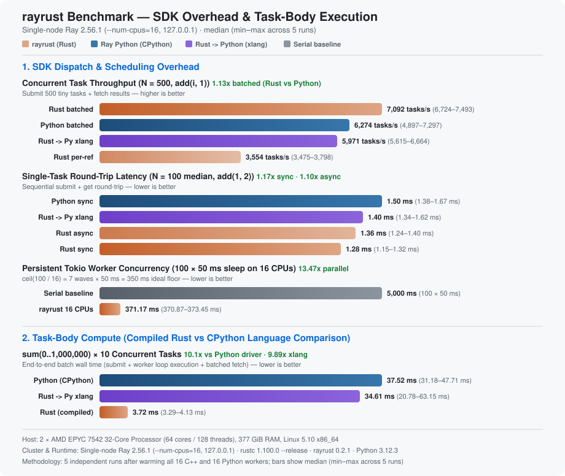

# rayrust

[English](README.md) | [中文](README_CN.md)

A Rust SDK for [Ray](https://ray.io) — the distributed computing framework for scaling AI and Python applications.

rayrust wraps the Ray C++ SDK (`libray_api.so`) via a C ABI layer, providing idiomatic Rust APIs for Ray's core distributed primitives: object store, remote tasks, actors, placement groups, and cross-language calls.

## Features

| Feature | Local Mode | Cluster Mode |
|---|:---:|:---:|
| `Ray::connect` / `drop` (RAII lifecycle) | ✅ | ✅ |
| `put` / `get` / `wait` | ✅ | ✅ |
| `get_many` / `get_many_timeout` (batch get, optional deadline) | ✅ | ✅ |
| `get_many_async` / `get_many_timeout_async` / `wait_async` (batch `Get` and `Wait` on the tokio blocking pool) | ✅ | ✅ |
| `#[remote]` sync task | ✅ | ✅ |
| `#[remote]` async task (persistent runtime) | ✅ | ✅ |
| `#[actor]` macro (auto-generate factory + methods) | ✅ | ✅ |
| `actor_call_async` (non-blocking) | ✅ | ✅ |
| `get_async` (bounded `Get` on the tokio blocking pool) | ✅ | ✅ |
| Python task (cross-language, complex types) | ✅ | ✅ |
| Python actor (cross-language; local mode refuses creation #68 and calls #59) | ❌ | ✅ |
| Resource scheduling (`TaskOptions` / `ActorOptions` builder) | ✅ | ✅ |
| `ActorOptions`: name, namespace, max_restarts, max_concurrency, runtime_env, placement_group | ✅ | ✅ |
| `ActorLifetime::Detached` (detached actors) | ✅ | ✅ |
| `RayConfig.namespace` (job-level namespace) | ✅ | ✅ |
| PlacementGroup | ✅ | ✅ |
| `get_actor` (named actor, cross-namespace) | ✅ | ✅ |
| `cancel` (task cancellation; local mode has no cancellation path and returns an error, see #58) | ❌ | ✅ |
| `kill_actor` (local mode returns an error and the actor ends with the process, see #53) | ❌ | ✅ |
| XLANG header auto-detection (Ray 2.51.1+ compatible) | ✅ | ✅ |
| `rmpv::Value` dynamic deserialization | ✅ | ✅ |
| `put_xlang` (writes the xlang header into the stored data; Python still rejects it for lack of metadata, see #21) | ✅ | ✅ |
| `ray_last_error()` (thread-local error messages) | ✅ | ✅ |

## Quick Start

### Prerequisites

**No Python installation required.** The build system automatically downloads the Ray C++ SDK from PyPI:

```bash
git clone https://github.com/NolanHo/rayrust.git
cd rayrust
cargo build --release -p rayrust-example-worker
```

The first build will download the Ray wheel (~71MB) from PyPI and extract the C++ SDK to `~/.cache/rayrust/`. Subsequent builds reuse the cache.

**Optional:** To use a pre-installed Ray C++ SDK (e.g. from `pip install ray[cpp]`):

```bash
export RAY_CPP_DIR=/path/to/site-packages/ray/cpp
```

### Run in local mode (no cluster needed)

```bash
cargo run --example hello_ray
```

### Run against a Ray cluster

```bash
export RAY_ADDRESS='<head-node-ip>:6379'
export RAY_NODE_IP='<this-node-ip>'
export RAY_WORKER_SO="$(pwd)/target/release/librayrust_worker.so"
export LD_LIBRARY_PATH="$HOME/.cache/rayrust/ray-cpp-2.51.1/lib:$LD_LIBRARY_PATH"

cargo run --example full_test
```

## Usage

### Remote Tasks (`#[remote]`)

Supports sync and `async fn`. Async functions use a persistent global tokio runtime (created once, reused across calls).

```rust
use rayrust::prelude::*;

#[rayrust::remote]
fn add(a: i32, b: i32) -> i32 { a + b }

#[rayrust::remote]
async fn fetch(url: String) -> Vec<u8> { /* ... */ }

#[tokio::main]
async fn main() -> Result<(), RayError> {
    let ray = Ray::connect(&RayConfig::new("127.0.0.1:6379"))?;

    // Async get: one bounded Get runs on the tokio blocking pool, so no tokio thread is held
    let r = add_remote(&ray, 1, 2)?;
    let v: i32 = r.get_async().await?;
    println!("add(1, 2) = {}", v);

    // Async submission (concurrent)
    let r = add_remote_async(&ray, 10, 20).await?;
    let v: i32 = r.get_async().await?;

    drop(ray);
    Ok(())
}
```

### Passing an `ObjectRef` as an argument

A reference can stand in for a value parameter: pass `ObjectRef<T>` (the handle moves into the call) or `&ObjectRef<T>` (the handle stays with you; one reference is cloned for the duration of the submission), and the driver does not have to `get` the value first. In cluster mode the core worker delivers the object's value to the worker; in local mode the C wrapper reads it before submission. The generated caller holds its own reference until the submission call returns, so dropping your handle before an async future is polled is safe.

```rust
let a = ray.put(&40i32)?;
let sum: ObjectRef<i32> = add_remote(&ray, 2, &a)?;  // same as add_remote(&ray, 2, 40)
let v: i32 = sum.get_async().await?;                 // 42
```

Every macro-generated caller returns `Result`, so argument serialization and submission errors both reach the caller instead of panicking. Actor methods take references the same way (`counter_increment(&ray, &handle, &a)`).

Two limits come with this feature. A reference the driver put can only be handed to Rust tasks and actors: Python rejects an object without metadata, and the C++ SDK's `put` writes none. And a Rust task cannot hand back a usable reference: the id it returns carries no nested references, and the driver has no owner path for it, so reading that id gives `ObjectUnknownOwner` even while the object is alive. Both limits are documented on `rayrust::TaskArg`.

### Actors (`#[actor]` macro)

The `#[rayrust::actor]` macro auto-generates the factory callback, member function callbacks, `#[ctor]` registration, and convenience callers:

```rust
use rayrust::prelude::*;

struct Counter { value: i64 }

#[rayrust::actor]
impl Counter {
    fn new(start: i64) -> Self {
        Counter { value: start }
    }

    fn increment(&mut self, n: i64) -> i64 {
        self.value += n;
        self.value
    }

    fn get(&self) -> i64 {
        self.value
    }
}

#[tokio::main]
async fn main() -> Result<(), RayError> {
    let ray = Ray::connect(&RayConfig::new("127.0.0.1:6379"))?;

    // Create actor via macro-generated factory
    let arg = serialize(&100i64)?;
    let handle = ray.actor_create(
        "__rayrust_actor_factory_counter", &[&arg], &ActorOptions::new()
    )?;

    // Call methods asynchronously
    let arg = serialize(&5i64)?;
    let r = ray.actor_call_async(
        handle.id(),
        "__rayrust_actor_factory_counter::increment",
        vec![arg],
        vec![],
    ).await?.cast::<i64>();
    let v = r.get_async().await?; // 105

    ray.kill_actor(&handle, true)?;
    drop(ray);
    Ok(())
}
```

### Cross-language (Python)

Rust ↔ Python with automatic XLANG header handling and complex type support:

```rust
// Python → Rust: list, dict, nested, None, mixed types
let obj = ray.task_call_python("my_module", "return_list", &[], &[])?;
let val: Vec<i64> = obj.cast().get_async().await?; // [1, 2, 3, 4, 5]

// Dynamic type (when return type is unknown)
let obj = ray.task_call_python("my_module", "complex_func", &[], &[])?;
let val = obj.get_value_async().await?; // rmpv::Value

// Rust → Python: send complex args
let arg = serialize(&vec![1i64, 2, 3])?;
let obj = ray.task_call_python("my_module", "echo_list", &[&arg], &[])?;
```

### Resource Scheduling

Request CPU/GPU resources for tasks and actors:

```rust
// Task with GPU
let obj = ray.task_call(
    "train_model", &args, &[], &TaskOptions::new().resource("GPU", 1.0).resource("CPU", 4.0)
)?;

// Actor with resources
let handle = ray.actor_create(
    "gpu_actor_factory", &args, &ActorOptions::new().resource("GPU", 1.0)
)?;
```

In cluster mode every task requests one CPU by default, the same default
Python's `@ray.remote` applies, so `--num-cpus` limits how many tasks run at
once. To ask for zero CPU (a task that only waits or only does I/O and should not
hold a CPU slot), say `.resource("CPU", 0.0)` explicitly. Giving another
resource without a `CPU` key still leaves the task at one CPU: the default 1.0 is
merged in. This covers both `Ray::task_call` and `Ray::task_call_python`; the
latter takes no options and so always requests one CPU. Local mode drops
resource requirements entirely, so none of this applies there.

An actor is different: `ActorOptions` has no default, so an actor without
`resources` reserves no CPU for its lifetime. That matches Python's no-options
actor; an actor that names some other resource reserves no CPU here, while
Python additionally reserves one (#55).

### Object Store

```rust
let obj = ray.put(&42i32)?;
let val: i32 = ray.get(&obj)?;

// Async put/get
let obj = ray.put_async(42i32).await?;
let val: i32 = obj.get_async().await?;

// Batch get
let vals = ray.get_many(&[obj1, obj2, obj3])?;

// Wait for readiness
let (ready, unready) = ray.wait(&[obj1, obj2], 2, 5000)?;
```

In cluster mode (the core worker is initialized) the `ObjectRef` returned by
`put` and by a task or actor call holds one Ray local reference for its id:
`Clone` adds one and `Drop` removes one, so the object lives while at least one
such reference exists and may be freed once the last one is dropped. Local mode
and Ray worker processes do not take part in reference counting, so dropping a
reference there frees nothing. A reference rebuilt from id bytes
(`ObjectRef::from(id_bytes)`) holds no reference at all: whether the object is
still alive is up to whoever else holds it, so read it with `get_timeout`.

## Architecture

```
Rust application code
    |
    v
rayrust (safe Rust API)
    Ray (RAII context: connect / drop)
    ObjectRef<T>, ActorHandle, ActorOptions, TaskOptions
    TaskArg / TaskArgs (value or &ObjectRef<T> per argument)
    #[remote]/#[actor] macros → &Ray callers
    get_async (bounded `Get` on the tokio blocking pool), persistent tokio runtime
    |
    v
rayrust-sys (FFI bindings)
    extern "C" declarations, build.rs (auto-download SDK from PyPI)
    |
    v
ray_c.h / ray_c.cc (C ABI wrapper)
    Type-erased C interface, binary-safe IDs
    Thread-local error messages, resource scheduling
    |
    v
libray_api.so (Ray C++ SDK)  ->  Ray Core (raylet / GCS / object store)
```

## Build System

The `build.rs` in `rayrust-sys` handles SDK acquisition:

1. **`RAY_CPP_DIR` env var** — use a pre-installed SDK
2. **`~/.cache/rayrust/ray-cpp-{version}/`** — shared cache (debug + release)
3. **Auto-download from PyPI** — downloads wheel, extracts `ray/cpp/`

Override the Ray version with `RAY_VERSION=2.51.1`.

## Key Design Decisions

| Decision | Reason |
|---|---|
| Wrap C++ SDK, not native rewrite | `libray_api.so` is 38MB of Bazel-built code |
| C ABI wrapper | C++ templates have no stable ABI |
| build.rs auto-download | No Python dependency for building |
| Binary-safe IDs (`ptr + len`) | Ray ObjectIDs may contain null bytes |
| XLANG header auto-detection | Ray 2.51.1+ changed header format (non-zero padding) |
| `rmpv::Value` for dynamic types | Python returns unknown types at compile time |
| Persistent global tokio runtime | Avoid per-call runtime creation overhead |
| `#[actor]` macro | Reduces 40 lines of boilerplate to 10 |
| Thread-local `ray_last_error()` | Structured error propagation from C++ to Rust |
| `clear_error()` before FFI call | Prevents stale errors from prior operations |

## Design Paradigm

rayrust follows idiomatic Rust patterns, not C-in-Rust:

### RAII Context — `Ray`

All operations are methods on a `Ray` context object. All handles in a process share one runtime, and `shutdown()` runs when the last handle is dropped — impossible to forget cleanup, even on panic. A second `connect` with the same config returns the runtime that is already live instead of initializing it again; a different config is refused with `RayError::Runtime`. `Ray` is `!Clone` (pass `&Ray` to share).

```rust
let ray = Ray::connect(&config)?;  // init
let obj = ray.put(&42i32)?;         // method call
// drop(ray) → automatic shutdown
```

### Builder Pattern — `RayConfig`, `ActorOptions`, `TaskOptions`

All configuration uses chainable builder methods returning `Self`:

```rust
let config = RayConfig::new("127.0.0.1:6379")
    .node_ip("192.168.1.5")
    .namespace("production")
    .detached_actors();

let opts = ActorOptions::new()
    .name("counter")
    .max_restarts(3)
    .max_concurrency(10)
    .resource("GPU", 1.0);
```

### `'static` Futures — async methods don't borrow `&Ray`

`task_call_async` and `actor_call_async` return `impl Future + Send + 'static`. The `&Ray` reference is only needed to submit the task, not to poll the result. This allows spawning futures on `JoinSet` without lifetime issues:

```rust
// These futures can be spawned on JoinSet — no &ray borrow needed
let futs = (0..10).map(|i| add_remote_async(&ray, i, 1));
```

### Error Handling — `Result` everywhere, no hidden panics

`put`, `kill_actor`, `get_actor`, and every macro-generated caller return `Result`: argument serialization and task/actor submission errors both reach the caller instead of panicking. The C ABI's thread-local `last_error()` is checked after FFI calls and `clear_error()` is called before to prevent stale errors.

## Benchmark

Rust vs Python on Ray cluster (500 tasks):



| Metric | Rust | Python | Speedup |
|---|---|---|---|
| Async throughput | 4744 tasks/sec | 1918 tasks/sec | **2.5x** |
| Latency (median) | 617µs | 950µs | **1.5x** |
| Compute (sum 0..1M) | 2.8ms | 652ms | **234x** |
| Async runtime (100×50ms) | 521ms (9.6x parallel) | — | — |

## Cluster Setup

### Multi-node C++ Actor Support

Rust actors use the Ray C++ SDK's worker process (`default_worker`). Every node that may run C++ actors **must** have `ray[cpp]` installed:

```bash
# On ALL worker nodes (not just the driver node):
pip install "ray[cpp]==2.51.1"
```

If a node only has `pip install ray` (Python only, no `[cpp]` extra), it lacks:
- `ray/cpp/default_worker` — the C++ worker binary that Ray's raylet launches
- `ray/cpp/lib/libray_api.so` — the C++ SDK shared library

C++ actors scheduled to such nodes will crash immediately (`never_started: true`, `NODE_DIED`).

**Symptom**: `actor_create()` succeeds (returns an actor ID), but `actor_call()` hangs until timeout. Driver log shows `NODE_DIED` / `health check failed due to missing too many heartbeats`.

**Quick check** — verify C++ SDK on each node:
```bash
ssh <worker-node> 'test -f $(python3 -c "import ray,os;print(os.path.join(os.path.dirname(ray.__file__),\"cpp\",\"default_worker\"))") && echo "C++ SDK OK" || echo "MISSING: install ray[cpp]"'
```

**Workaround**: If only the driver node has the C++ SDK, use local mode or single-node cluster:
```bash
ray start --head --port=6380  # on the node with ray[cpp] installed
```

### Remote Tasks vs Actors

| Feature | Needs `ray[cpp]` on worker nodes? | Why |
|---|---|---|
| `put` / `get` / `wait` | No | Runs in driver process |
| `#[remote]` task | No | Executes in driver's local worker |
| `#[actor]` (cluster mode) | **Yes** | Ray launches `default_worker` on a worker node |
| `#[actor]` (local mode) | No | Everything runs in-process |
| Python task/actor (xlang) | No | Uses Python workers (available everywhere) |

### Worker `.so` RPATH (dlopen compatibility)

When Ray's `default_worker` dlopens your `librayrust_worker.so`, the dynamic linker searches for `libray_api.so` (a NEEDED dependency) using the `.so`'s own `DT_RPATH` — **not** `LD_LIBRARY_PATH` from the calling process. Without RPATH, the worker `.so` fails to load with `libray_api.so: cannot open shared object file`.

The `rayrust-example-worker` build script sets this automatically:

```bash
# Verify: should show DT_RPATH (not DT_RUNPATH)
readelf -d target/release/librayrust_worker.so | grep RPATH
# 0x000000000000000f (RPATH) Library rpath: [$ORIGIN:/path/to/ray/cpp/lib]
```

**If you build your own worker crate** (not using `rayrust-example-worker`), add this to your `build.rs`:

```rust
fn main() {
    // ... locate ray_cpp_dir (RAY_CPP_DIR or pip-installed) ...

    let lib_dir = std::path::PathBuf::from(&ray_cpp_dir).join("lib");
    println!("cargo:rustc-link-search=native={}", lib_dir.display());

    // DT_RPATH: searched by dlopen, inherited by transitive deps.
    //   1. $ORIGIN — copy libray_api.so next to your worker .so (deployment)
    //   2. absolute path — same machine builds and runs (dev)
    println!("cargo:rustc-link-arg-cdylib=-Wl,--disable-new-dtags");
    println!("cargo:rustc-link-arg-cdylib=-Wl,-rpath,$ORIGIN");
    println!("cargo:rustc-link-arg-cdylib=-Wl,-rpath,{}", lib_dir.display());

    // Force libray_api.so into NEEDED (linker may drop unreferenced libs).
    println!("cargo:rustc-link-arg-cdylib=-Wl,--no-as-needed");
    println!("cargo:rustc-link-arg-cdylib=-lray_api");
    println!("cargo:rustc-link-arg-cdylib=-Wl,--as-needed");
}
```

| Deployment method | How it works |
|---|---|
| **Dev (same machine)** | RPATH entry #2 points to `ray/cpp/lib` — automatic |
| **Cluster (copy .so)** | Copy `libray_api.so` to the same directory as your worker `.so` — RPATH entry #1 (`$ORIGIN`) finds it |
| **Cluster (shared path)** | Set `RAY_CPP_DIR` at build time so RPATH points to the worker node's `ray/cpp/lib` |

## Examples

| Example | Description |
|---|---|
| `hello_ray` | Basic put/get/init |
| `full_test` | All features (tasks, actors, xlang, placement groups) |
| `async_demo` | Concurrent async tasks with tokio |
| `xlang_complex` | Cross-language complex types (11 tests) |
| `actor_e2e` | Rust actor e2e with `#[actor]` macro |
| `raybench` | Performance benchmark (Rust vs Python) |

## License

Apache-2.0 (same as Ray)
