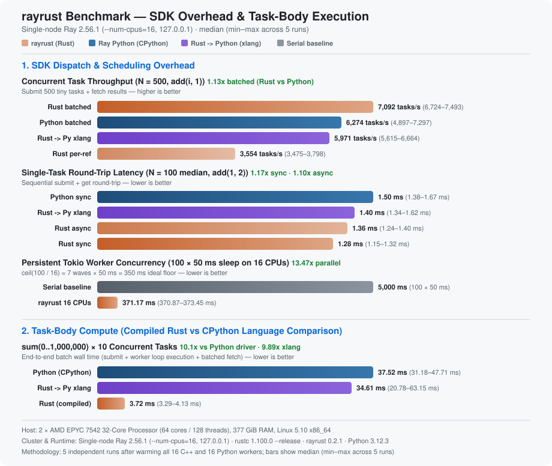

# rayrust

[English](README.md) | [中文](README_CN.md)

Ray 的 Rust SDK —— 通过 FFI 封装 Ray C++ SDK，提供地道的 Rust API 来使用 Ray 的核心分布式原语：对象存储、远程任务、Actor、Placement Group 和跨语言调用。

## 特性

| 特性 | 本地模式 | 集群模式 |
|---|:---:|:---:|
| `Ray::connect` / `Ray::local` / `drop`（RAII 生命周期管理；`Ray::local()` 为本地模式快捷入口） | ✅ | ✅ |
| `put` / `get` / `wait` | ✅ | ✅ |
| `get_many` / `get_many_timeout`（批量获取，可带期限；一次 `Wait` 加逐元素 `Get`，见 #41） | ✅ | ✅ |
| `get_many_async` / `get_many_timeout_async` / `wait_async`（批量获取与 `Wait` 跑在 tokio blocking pool 上） | ✅ | ✅ |
| `#[remote]` 同步任务 | ✅ | ✅ |
| `#[remote]` 异步任务（持久化 runtime） | ✅ | ✅ |
| `#[actor]` 宏（自动生成 factory + 方法） | ✅ | ✅ |
| `actor_call_async`（非阻塞） | ✅ | ✅ |
| `get_async`（带期限的 `Get` 跑在 tokio blocking pool 上） | ✅ | ✅ |
| Python 任务（跨语言，复杂类型） | ✅ | ✅ |
| Python Actor（跨语言；本地模式拒绝创建（#68）与调用（#59）） | ❌ | ✅ |
| 资源调度（`TaskOptions` / `ActorOptions` builder） | ✅ | ✅ |
| `ActorOptions`：name、namespace、max_restarts、max_concurrency、runtime_env、placement_group | ✅ | ✅ |
| `ActorLifetime::Detached`（detached actor） | ✅ | ✅ |
| `RayConfig.namespace`（job 级命名空间） | ✅ | ✅ |
| PlacementGroup | ✅ | ✅ |
| `get_actor`（命名 actor，跨 namespace） | ✅ | ✅ |
| `cancel`（任务取消；本地模式没有取消路径，返回错误，见 #58） | ❌ | ✅ |
| `kill_actor`（本地模式返回错误，actor 随进程结束，见 #53） | ❌ | ✅ |
| XLANG header 自动检测（兼容 Ray 2.56.1+） | ✅ | ✅ |
| `rmpv::Value` 动态反序列化 | ✅ | ✅ |
| `put_xlang`（集群模式经 `CoreWorker::Put` 写入 9 字节 XLANG 头与 `XLANG` metadata；本地模式无 `CoreWorker` 与 Python 执行器，返回错误，见 #21） | ❌ | ✅ |
| `ActorHandle::serialize()` / `ActorHandle::from_serialized()`（跨进程交接 actor 句柄；本地模式无 `CoreWorker`，返回 `RayError::Ffi`） | ❌ | ✅ |
| `exit_actor()` / `Ray::was_current_actor_restarted()`（actor 方法内的生命周期辅助接口；本地模式下 `exit_actor()` 为空操作且 `was_current_actor_restarted()` 始终返回 `false`） | ✅ | ✅ |
| 指标 API（基于 `libray_api.so` 的 `Gauge`、`Counter`、`Histogram`、`Sum`；本地模式空操作返回；上游将 `metrics_agent_port` 固定为 `-1`，仅在进程内注册与聚合） | ✅ | ✅ |
| `ray_last_error_bytes()`（带长度的线程局部错误字节；Rust 提取格式化异常文本，失败时按 UTF-8 lossy 回退） | ✅ | ✅ |

## 快速开始

### 前置条件

通过预先安装的 `ray[cpp]`、`RAY_CPP_DIR` 环境变量或显式开启 PyPI 下载（`RAYRUST_DOWNLOAD=1`）提供 Ray C++ SDK：

```bash
git clone https://github.com/NolanHo/rayrust.git
cd rayrust
RAYRUST_DOWNLOAD=1 cargo build --release -p rayrust-example-worker
```

设置 `RAYRUST_DOWNLOAD=1` 时，首次构建从 PyPI 下载 `ray-cpp` wheel、校验 SHA-256 摘要并解压 C++ SDK 到 `~/.cache/rayrust/`；后续构建直接复用缓存，无需继续设置 `RAYRUST_DOWNLOAD=1`。

使用预先安装的 Ray C++ SDK（如 `pip install ray[cpp]`）：

```bash
export RAY_CPP_DIR=/path/to/site-packages/ray/cpp
```

### 本地模式运行（无需集群）

```bash
cargo run --example hello_ray
```

### 集群模式运行

```bash
export RAY_ADDRESS='<head节点IP>:6379'
export RAY_NODE_IP='<本机IP>'
export RAY_WORKER_SO="$(pwd)/target/release/librayrust_worker.so"

cargo run --example full_test
```

在 Linux 上，构建过程会把 SDK 的 `lib` 目录写进本仓库构建出的二进制、测试与 worker `.so` 的 RPATH，`cargo test` 与 `cargo run --example ...` 可直接使用；`LD_LIBRARY_PATH` 仅在构建完成后移动了 SDK 目录时才需要。把自己的 crate 依赖 `rayrust` 时不会继承这些条目：需要在自身构建配置里加链接参数，或在运行它的时候设置 `LD_LIBRARY_PATH`。

## 使用方式

### 远程任务（`#[remote]`）

支持同步和 `async fn`。异步函数使用持久化全局 tokio runtime（创建一次，复用调用）。

```rust
use rayrust::prelude::*;

#[rayrust::remote]
fn add(a: i32, b: i32) -> i32 { a + b }

#[rayrust::remote]
async fn fetch(url: String) -> Vec<u8> { /* ... */ }

#[tokio::main]
async fn main() -> Result<(), RayError> {
    let ray = Ray::connect(&RayConfig::new("127.0.0.1:6379"))?;

    // 异步获取：一次带期限的 Get 跑在 tokio blocking pool 上，tokio 线程不被占用
    let r = add_remote(&ray, 1, 2)?;
    let v: i32 = r.get_async().await?;
    println!("add(1, 2) = {}", v);

    // 异步提交（并发）
    let r = add_remote_async(&ray, 10, 20).await?;
    let v: i32 = r.get_async().await?;

    drop(ray);
    Ok(())
}
```

### 引用参数

引用可以顶替一个值参数：传 `ObjectRef<T>`（句柄转移进调用）或 `&ObjectRef<T>`（调用方保留句柄，调用器克隆一份），驱动不必先 `get`。集群模式下 core worker 把对象的值投递给工人，本地模式下 C 包装层在提交前取成值。生成的调用器自己持有一份引用直到提交的 FFI 调用返回，所以异步 future 轮询之前 drop 掉自己的句柄是安全的。

```rust
let a = ray.put(&40i32)?;
let sum: ObjectRef<i32> = add_remote(&ray, 2, &a)?;  // 等价于 add_remote(&ray, 2, 40)
let v: i32 = sum.get_async().await?;                 // 42
```

宏生成的调用器都返回 `Result`：参数序列化错误与提交错误都回到调用方，不变成 panic。actor 方法的引用参数写法相同（`counter_increment(&ray, &handle, &a)`）。

这条能力有两条限制。Rust 任务与 actor 只接收 `Ray::put` 等非跨语言引用（C++ 工人不剥离 9 字节 XLANG 头，`TaskArg` 会将 `Ray::put_xlang` 句柄拒绝为 `RayError::Serialization`）；集群模式下向 Python 任务或 actor 按引用传参须使用 `Ray::put_xlang` 写入 `XLANG` metadata（`Ray::put` 不写 metadata，Python 侧会拒绝）。Rust 任务也不能把可用的引用交回来：它交回的 id 不附带嵌套引用，驱动侧也没有这个 id 的 owner 路径，所以读这个 id 得到 `ObjectUnknownOwner`，对象活着也一样。详见 `rayrust::TaskArg` 的文档。

### Actor（`#[actor]` 宏）

`#[rayrust::actor]` 宏自动生成 factory callback、成员函数 callback、`#[ctor]` 注册和便捷调用函数：

```rust
use rayrust::prelude::*;

struct Counter { value: i64 }

#[rayrust::actor]
impl Counter {
    fn new(start: i64) -> Self {
        Counter { value: start }
    }

    fn increment(&mut self, n: i64) -> i64 {
        self.value += n;
        self.value
    }

    fn get(&self) -> i64 {
        self.value
    }
}

#[tokio::main]
async fn main() -> Result<(), RayError> {
    let ray = Ray::connect(&RayConfig::new("127.0.0.1:6379"))?;

    // 通过宏生成的 factory 创建 Actor
    let arg = serialize(&100i64)?;
    let handle = ray.actor_create(
        "__rayrust_actor_factory_counter", &[&arg], &ActorOptions::new()
    )?;

    // 异步调用方法
    let arg = serialize(&5i64)?;
    let r = ray.actor_call_async(
        handle.id(),
        "__rayrust_actor_factory_counter::increment",
        vec![arg],
        vec![],
    ).await?.cast::<i64>();
    let v = r.get_async().await?; // 105

    ray.kill_actor(&handle, true)?;
    drop(ray);
    Ok(())
}
```

### 跨语言调用（Python）

Rust ↔ Python，自动处理 XLANG header，支持复杂类型：

```rust
// Python → Rust: list、dict、nested、None、混合类型
let obj = ray.task_call_python("my_module", "return_list", &[], &[])?;
let val: Vec<i64> = obj.cast().get_async().await?; // [1, 2, 3, 4, 5]

// 动态类型（返回类型未知时）
let obj = ray.task_call_python("my_module", "complex_func", &[], &[])?;
let val = obj.get_value_async().await?; // rmpv::Value

// Rust → Python: 发送复杂参数
let arg = serialize(&vec![1i64, 2, 3])?;
let obj = ray.task_call_python("my_module", "echo_list", &[&arg], &[])?;
```

### 资源调度

为 task 和 actor 请求 CPU/GPU 资源：

```rust
// 带 GPU 的 task
let obj = ray.task_call(
    "train_model", &args, &[], &TaskOptions::new().resource("GPU", 1.0).resource("CPU", 4.0)
)?;

// 带资源的 actor
let handle = ray.actor_create(
    "gpu_actor_factory", &args, &ActorOptions::new().resource("GPU", 1.0)
)?;
```

集群模式下每个任务默认请求 1 个 CPU（与 Python 的 `@ray.remote` 默认行为一致），因此 `--num-cpus` 会限制同时运行的任务数量。如果任务只需要等待或执行 I/O、不希望占用 CPU 槽位，可以通过 `.resource("CPU", 0.0)` 显式清零。仅指定其他资源而未设置 `CPU` 键时，默认值 `1.0` 仍会被合并进去，任务依旧请求 1 个 CPU。这一规则适用于两个接收 `TaskOptions` 的任务入口：`Ray::task_call` 与 `Ray::task_call_python_with_options` 都可以借此将 CPU 设为 0，而无选项入口 `Ray::task_call_python` 始终沿用 1 个 CPU 的默认值。本地模式会忽略全部资源需求，上述规则仅在集群模式生效。

Actor 在 C++ SDK 支持范围内遵循 Ray 的两套默认预设：未指定 `resources` 时，Actor 在整个生命周期内不预留 CPU（与 Python 无选项 Actor 一致；由于 `ActorCreationOptions` 不提供方法级 CPU 字段，方法调用本身也不占用 CPU）。一旦指定了除 `memory` 和 `object_store_memory` 之外的任何资源，就会默认同时为 Actor 的生命周期预留 1 个 CPU；调用 `.resource("CPU", 0.0)` 可显式取消该默认预留，仅指定 `memory` 或 `object_store_memory` 时同样保持为 0 CPU。

### 对象存储

```rust
let obj = ray.put(&42i32)?;
let val: i32 = ray.get(&obj)?;

// 异步 put/get
let obj = ray.put_async(42i32).await?;
let val: i32 = obj.get_async().await?;

// 批量获取
let vals = ray.get_many(&[obj1, obj2, obj3])?;

// 等待就绪
let (ready, unready) = ray.wait(&[obj1, obj2], 2, 5000)?;
```

`get_many*` 先按去重后的 ID 调用一次 `Wait`，再对每个就绪元素执行一次单对象 `Get`
（最多每个输入槽位一次）：上游 C++ SDK 的批量 `Get` 在含有异常对象的混合批次中会
留下空 `RayObject` 指针并在 `NativeObjectStore::GetRaw` 中直接解引用触发段错误
（见 #41）。这次 `Wait` 不会因为批次里已有失败对象而提前返回，所以含多个元素的批次
会等到全部就绪或期限到期：无期限的 `get_many` 会阻塞到每个元素就绪，带期限的入口
在期限到期后才报告首个失败元素。

集群模式（core worker 已初始化）下，`put` 与任务、actor 调用返回的 `ObjectRef` 为
它的 id 持有一个 Ray 本地引用：`Clone` 加一个、`Drop` 减一个，只要还有这样的引用
活着对象就活着，最后一个被 drop 之后对象可能被释放。本地模式与 Ray 工人进程不参与
引用计数，在那里 drop 引用不会释放任何东西。从 id 字节重建的引用
（`ObjectRef::from(id_bytes)`）不持有引用：对象能不能活到你读它的时候取决于别处
是否还有引用，读取时用 `get_timeout`。

### 指标

```rust
use rayrust::prelude::*;

let gauge = Gauge::new("queue_depth", "Pending items", "items", &["worker"])?;
gauge.set(4.0, &[("worker", "w1")])?;

let counter = Counter::new("requests_total", "Processed requests", "count", &["status"])?;
counter.inc(1.0, &[("status", "ok")])?;

let hist = Histogram::new(
    "request_latency_ms",
    "Request latency",
    "ms",
    &[1.0, 5.0, 10.0, 50.0],
    &["route"],
)?;
hist.observe(3.5, &[("route", "/predict")])?;

let sum = Sum::new("bytes_transferred", "Net payload delta", "bytes", &[])?;
sum.record(256.0, &[])?;
```

指标句柄可在 `Ray::connect` 之前或任务与 actor 内部构造，并可跨越运行时关闭与重建周期复用。录制调用在参数校验之后受活跃运行时的关闭闸门保护：本地模式不启动 `CoreWorker` 且作为空操作返回 `Ok(())`，集群模式受上游 `ProcessHelper::RayStart` 将 `CoreWorkerOptions::metrics_agent_port` 固定设为 `-1` 的限制只在进程内完成注册与聚合。

## 架构

```
Rust 应用代码
    |
    v
rayrust（安全 Rust API）
    Ray (RAII context: connect / drop)
    ObjectRef<T>, ActorHandle, ActorOptions, TaskOptions
    TaskArg / TaskArgs（每个参数是值或 &ObjectRef<T>）
    #[remote]/#[actor] 宏 → &Ray 调用器
    get_async (带期限的 `Get` 跑在 tokio blocking pool 上), 持久化 tokio runtime
    |
    v
rayrust-sys（FFI 绑定）
    extern "C" 声明, build.rs (SDK 查找；通过 RAYRUST_DOWNLOAD=1 显式开启 PyPI 下载)
    |
    v
ray_c.h / ray_c.cc（C ABI 封装层）
    类型擦除的 C 接口, 二进制安全的 ID
    线程局部错误消息, 资源调度
    |
    v
libray_api.so（Ray C++ SDK）  ->  Ray Core (raylet / GCS / object store)
```

## 构建系统

`rayrust` 要求 **`Ray >= 2.56.1`**，任何低于 `2.56.1` 的 `RAY_VERSION` 或 `RAY_CPP_DIR` SDK 在构建期即被拒绝。各包的 `build.rs` 共用 `rayrust-build` 获取 Ray C++ SDK：

1. **`RAY_CPP_DIR` 环境变量** — 使用指定的 SDK 目录（探测最低支持版本 `>= 2.56.1`，无需与 `RAY_VERSION` 相同）
2. **`~/.cache/rayrust/ray-cpp-{version}-{platform}/`**（或 `$RAYRUST_CACHE_DIR/ray-cpp-{version}-{platform}/`）— 共享缓存（debug + release）
3. **`python3`（`ray[cpp]`）** — 在 `sys.path` 中查找已安装的 `ray/cpp/`，要求其 `ray` 版本与 `RAY_VERSION` 一致
4. **显式开启从 PyPI 下载（`RAYRUST_DOWNLOAD=1`）** — 仅在启用 `RAYRUST_DOWNLOAD`（`1`/`true`/`yes`；`0`/`false`/`no` 或未设置时关闭）时执行：从 PyPI JSON 索引获取对应版本的 `ray-cpp` wheel，按 `digests.sha256` 流式校验 SHA-256（摘要写进缓存旁边的 `ray-cpp-{version}-{platform}.sha256`），解开 `ray/cpp/`。不设置该变量时构建不发出任何网络请求，失败信息列出取得 SDK 的三种办法（设置 `RAY_CPP_DIR`、`pip install ray[cpp]` 或设置 `RAYRUST_DOWNLOAD=1`）。

`RAY_VERSION`（默认 `2.56.1`）决定第 2 步的缓存目录名、第 3 步的版本匹配与第 4 步下载的 wheel；第 1 步直接使用 `RAY_CPP_DIR` 给出的目录并校验其版本 `>= 2.56.1`。缓存目录旁的 `.sha256` pin 文件记录下载时的产物身份；缓存命中时读取并校验该 pin 文件格式，每次构建不重新计算 SDK 目录内容的哈希。

`RAY_CPP_DIR` 与 `RAYRUST_CACHE_DIR` 中的相对路径按执行 `cargo` 的目录（`PWD`；`PWD` 未设时按工作区根）解释；`~` 不做展开，需要家用目录时写 `$HOME`。

构建警告会打印解析到的 SDK 路径、来源与 Ray 版本：

- `cargo:warning=Using Ray C++ SDK at <dir> (from RAY_CPP_DIR, version not checked)`
- `cargo:warning=Using Ray C++ SDK at <dir> (from cache, Ray <ver>)`（存在 `.sha256` pin 文件时为 `(from cache, Ray <ver>, sha256 <64 个十六进制字符的摘要>)`）
- `cargo:warning=Using Ray C++ SDK at <dir> (from python3, Ray <ver>)`
- `cargo:warning=Using Ray C++ SDK at <dir> (from download, Ray <ver>, sha256 <64 个十六进制字符的摘要>)`

构建期 `rayrust-sys/build.rs` 从 `libray_api.so` 的 ELF64 `SHT_SYMTAB` 提取 `_ZL11kRayVersion`（无符号表时读取 `../_version.py`），校验版本 `>= 2.56.1` 并记录为 `RAYRUST_BUILD_RAY_VERSION`，同时通过 `ray::RuntimeEnv::Deserialize` 导出符号探测 `_GLIBCXX_USE_CXX11_ABI` 并校验 136 字节 `ray::RayObject` 布局。运行期 `Ray::connect` 与工人回调核对已加载 `libray_api.so` 的 `kRayVersion` 与构建版本一致；集群模式下连接时通过 `dlsym` 解析的 `ray::gcs::GlobalStateAccessor::GetInternalKV` 自动读取 GCS 内部 KV `("cluster", "CLUSTER_METADATA")`，校验集群 `ray_version` 与构建版本一致（低于 `2.56.1` 时同时指明最低版本要求 `Ray >= 2.56.1`）。

## 关键设计决策

| 决策 | 原因 |
|---|---|
| 封装 C++ SDK，非原生重写 | `libray_api.so` 是 38MB 的 Bazel 产物 |
| C ABI 封装层 | C++ 模板无稳定 ABI |
| `build.rs` 显式下载开关（`RAYRUST_DOWNLOAD=1`） | 默认不联网；开启后经 SHA-256 校验获取 wheel，构建无需依赖 Python 环境 |
| 二进制安全 ID（`ptr + len`） | Ray ObjectID 可能包含 null 字节 |
| XLANG header 自动检测 | Ray 2.56.1+ header 格式（非零 padding） |
| `rmpv::Value` 动态类型 | Python 返回类型编译时未知 |
| 持久化全局 tokio runtime | 避免每次调用创建 runtime 的开销 |
| `#[actor]` 宏 | 将 40 行样板代码减少到 10 行 |
| 线程局部 `ray_last_error_bytes()` | 带长度的错误字节从 C++ 传到 Rust，`last_error()` 提取格式化异常文本并在无法提取时按 UTF-8 lossy 呈现原始字节 |
| FFI 调用前 `clear_error()` | 防止上次操作的残留错误被误报 |

## 编程范式

rayrust 遵循地道的 Rust 设计模式，而非 C 风格的全局函数：

### RAII Context — `Ray`

所有操作都是 `Ray` 上下文对象的方法。同一进程里的所有句柄共享一个运行时，`shutdown()` 在最后一个句柄 drop 时执行 —— 不可能忘记清理，即使 panic 也能正确关闭。同配置的第二次 `connect` 返回已经在运行的运行时，不会重新初始化；配置不同则返回 `RayError::Runtime`。`Ray` 是 `!Clone`（传 `&Ray` 共享）。

```rust
let ray = Ray::connect(&config)?;  // 初始化
let obj = ray.put(&42i32)?;         // 方法调用
// drop(ray) → 自动 shutdown
```

### Builder 模式 — `RayConfig`、`ActorOptions`、`TaskOptions`

所有配置类使用链式 builder 方法，返回 `Self`：

```rust
let config = RayConfig::new("127.0.0.1:6379")
    .node_ip("192.168.1.5")
    .namespace("production")
    .detached_actors();

let opts = ActorOptions::new()
    .name("counter")
    .max_restarts(3)
    .max_concurrency(10)
    .resource("GPU", 1.0);
```

### `'static` Future — async 方法不借用 `&Ray`

`task_call_async` 和 `actor_call_async` 返回 `impl Future + Send + 'static`。`&Ray` 引用仅在提交任务时需要，不跨 `.await` 存活。因此可以在 `JoinSet` 上 spawn，无生命周期问题：

```rust
// 这些 future 可以 spawn 到 JoinSet —— 不需要借用 &ray
let futs = (0..10).map(|i| add_remote_async(&ray, i, 1));
```

### 错误处理 —— 全部 `Result`，无隐藏 panic

`put`、`kill_actor`、`get_actor` 与全部宏生成的调用器都返回 `Result`：参数序列化错误与任务、actor 提交错误都回到调用方，不变成 panic。`Ray::connect` 在进入 SDK 之前校验 `RayConfig::address` 与 `RayConfig::runtime_env`，畸形 `runtime_env` JSON（或非对象的合法 JSON 值）返回 `Err`，不会终止进程。C ABI 的线程局部 `last_error()` 在 FFI 调用后检查，调用前 `clear_error()` 防止残留错误。失败的任务与 actor 从错误载荷中提取格式化异常文本（如 Python traceback），无法提取时按 UTF-8 lossy 呈现原始字节。C++ SDK 未翻译的错误类型以 `RayError::Unclassified` 返回：不带错误文本的对象（如已取消的任务）由消息说明该情况并点名 `TASK_CANCELLED`；携带错误帧的对象（如 `runtime_env` 安装失败）在解码之前就被识别，因此 `get`、`get_value`、`Vec<u8>` 以及批量与异步入口都返回 Ray 记录的错误文本，不把帧字节当成值解出来。判定要求载荷严格满足帧规则（总长为 `9 + N`、正文是 msgpack `bin`、protobuf 顶层字段号与 wire type 都在允许集合内、文本非空且是合法 UTF-8），正常值不会被改判；恰好满足这些规则的载荷会以 `RayError::Unclassified` 返回，该载荷因此不再参与解码。`#[remote]` 与 `#[actor]` 生成的工人回调将参数解码错误与函数体 `panic!` 捕获并通过回调错误通道回传为任务错误，不会跨 `extern "C"` 终止工人进程。

## 性能基准



### 测试环境与统计口径

- **主机配置**：`2 × AMD EPYC 7542 32-Core Processor`（64 物理核心 / 128 线程），377 GiB 内存，Linux 5.10 `x86_64`
- **集群形态**：单节点 Ray 2.56.1 集群（`--num-cpus=16`，`127.0.0.1` 本地回环）
- **构建与运行时**：`rustc 1.100.0`（`--release`）、`rayrust 0.2.1`、`Python 3.12.3`、`ray[cpp]==2.56.1`
- **统计口径**：预热全部 16 个 C++ worker 与 16 个 Python worker 后连续独立运行 5 轮；单元格展示 **5 轮中位数（`最小值–最大值`）**

### 1. SDK 调度与对象存储开销（微型任务与并发等待）

微型任务（`add(a, b)`）耗时主要由跨进程 RPC、raylet 调度与对象存储往返决定，`rayrust`（经 `libray_api.so`）与 `Ray Python` 处于同一数量级。并发等待批量任务时，使用 `Ray::get_many_async` 执行一次批量 `Wait` 的吞吐约为逐引用 `ObjectRef::get_async` 的 2.0 倍（`7,092` 对比 `3,554 tasks/s`）。

| 指标 | Rust（`rayrust`） | Python（`ray`） | 中位数比值 |
|---|---|---|---|
| 并发吞吐，批量获取（`N=500`，`add_remote_async` + `get_many_async` 对比 `ray.get(refs)`） | 7,092 tasks/s（6,724–7,493）<br>70.50 ms（66.73–74.36） | 6,274 tasks/s（4,897–7,297）<br>79.69 ms（68.52–102.09） | **1.13x** |
| 并发吞吐，逐引用获取（`N=500`，`JoinSet` + `ObjectRef::get_async`） | 3,554 tasks/s（3,475–3,798）<br>140.69 ms（131.66–143.87） | — | — |
| 跨语言并发吞吐，批量获取（`N=500`，Rust → Python `rayrust_test.add` + `get_many_async`） | 5,971 tasks/s（5,615–6,664）<br>83.73 ms（75.02–89.05） | 6,274 tasks/s（4,897–7,297） | **0.95x** |
| 顺序同步吞吐（`N=500`，`add_remote` + `get` 对比 `ray.get(add.remote)`） | 813 tasks/s（741–992）<br>614.66 ms（504.11–674.44） | 626 tasks/s（556–673）<br>798.09 ms（743.23–899.90） | **1.30x** |
| 单任务往返延迟，同步（`N=100`，`add(1, 2)`） | 中位数 1.28 ms（1.15–1.32）<br>p99 1.94 ms（1.55–2.17） | 中位数 1.50 ms（1.38–1.67）<br>p99 2.09 ms（1.72–7.94） | **1.17x**（中位数） |
| 单任务往返延迟，异步（`N=100`，`add_remote_async` + `get_async`） | 中位数 1.36 ms（1.24–1.40）<br>p99 1.95 ms（1.73–2.63） | — | **1.10x**（对比 Python 同步） |
| 跨语言单任务往返延迟（`N=100`，Rust → Python `rayrust_test.add`） | 中位数 1.40 ms（1.34–1.62）<br>p99 2.59 ms（2.06–3.86） | 中位数 1.50 ms（1.38–1.67） | **1.07x**（中位数） |
| 异步 worker 并发休眠（16 CPU 上 `100 × 50 ms` tokio 休眠，7 批理论下限 `350 ms`） | 371.17 ms（370.87–373.45） | — | **13.47x**（13.39–13.48x，对比串行 `5,000 ms`） |
| 复杂载荷往返（`100 × 100` 嵌套整数列表，`N=50` 顺序 `echo_list`） | 3.43 ms/iter（3.18–5.70）<br>纯 msgpack 128.35 µs · `put` 561.69 µs | 4.03 ms/iter（2.75–4.53） | **1.17x** |

### 2. 任务函数体执行速度对比（编译型 Rust 与解释型 CPython 语言对比）

下表对比任务函数体内纯循环计算（`sum(0..1_000_000)`）在编译型 Rust（`--release`）与解释型 CPython 3.12 下的执行速度；计时范围为 10 个并发任务从提交、worker 执行到批量取回（`get_many_async` / `ray.get(refs)`）的端到端总耗时：

| 负载 | 编译型 Rust（`compute`） | 解释型 CPython（Python 驱动 `pybench.py`） | 解释型 CPython（Rust 跨语言调用 `rayrust_test.compute`） | 语言计算加速比 |
|---|---|---|---|---|
| `sum(0..1_000_000) × 10` 并发任务（端到端批量总耗时） | 3.72 ms（3.29–4.13 ms） | 37.52 ms（31.18–47.71 ms） | 34.61 ms（20.78–63.15 ms） | **10.1x**（Python 驱动中位数比值）<br>**9.89x**（跨语言同轮配对中位数，范围 6.04–16.98x） |

### 复现命令

```bash
cargo build --release --all-targets
ray start --head --port=6379 --num-cpus=16 --include-dashboard=false

RAY_ADDRESS=127.0.0.1:6379 RAY_NODE_IP=127.0.0.1 cargo run --release --example raybench
RAY_ADDRESS=127.0.0.1:6379 RAY_NODE_IP=127.0.0.1 python3 tests/python/pybench.py

ray stop --force
```

## 集群配置

### 多节点 C++ Actor 支持

Rust Actor 与 `#[remote]` 任务都使用 Ray C++ SDK 的 worker 进程（`default_worker`）。每个可能运行它们的节点**必须**安装 `ray[cpp]`，并且该节点的相同 `code_search_path` 路径下必须存在对应的 Rust worker 动态库（`.so`）：

```bash
# 在所有 worker 节点上（不仅仅是 driver 节点）：
pip install "ray[cpp]==2.56.1"
```

如果节点只安装了 `pip install ray`（仅 Python，没有 `[cpp]`），则缺少：
- `ray/cpp/default_worker` — Ray raylet 启动的 C++ worker 二进制
- `ray/cpp/lib/libray_api.so` — C++ SDK 共享库

C++ Actor 被调度到此类节点会立即崩溃（`never_started: true`，`NODE_DIED`）。缺少 `default_worker` 时，`ray start` 传给 raylet 的 `--cpp_worker_command=` 为空，该 raylet 因此没有任何 C++ worker 状态，第一个 C++ 请求就会以 `Check failed: state != states_by_lang_.end() Required Language isn't supported: CPP`（`src/ray/raylet/worker_pool.cc:1623`）终止该节点的 raylet 进程：

- **driver 所在的节点**：`Ray::connect` 把 driver 作为 C++ worker 注册，本机 raylet 在 `WorkerPool::RegisterDriver` 中终止，driver 在打印 `Failed to register worker to Raylet: IOError: Failed to read data from the socket: End of file` 后以退出码 1 结束。
- **执行任务的 worker 节点**：`#[remote]` 任务提交成功，租约到达该节点后其 raylet 在 `WorkerPool::PrestartWorkers` 中终止；GCS 因心跳超时把该节点记为 `UNEXPECTED_TERMINATION`（`health check failed due to missing too many heartbeats`），driver 日志出现 `Retrying attempt to schedule lease ... Disconnected: GRPC client is shut down`，`get()` 持续等待具备 CPU 与 C++ worker 的节点。

**症状**：`actor_create()` 成功（返回 actor ID），但 `actor_call()` 超时挂起。Driver 日志显示 `NODE_DIED`。

**快速检查** — 验证各节点的 C++ SDK：
```bash
ssh <worker-node> 'test -f $(python3 -c "import ray,os;print(os.path.join(os.path.dirname(ray.__file__),\"cpp\",\"default_worker\"))") && echo "C++ SDK OK" || echo "缺失: 请安装 ray[cpp]"'
```

**变通方案**：如果只有 driver 节点有 C++ SDK，使用 local mode 或单节点集群：
```bash
ray start --head --port=6380  # 在安装了 ray[cpp] 的节点上
```

### 远程任务 vs Actor

| 功能 | 需要 worker 节点安装 `ray[cpp]`？ | 原因 |
|---|---|---|
| `put` / `get` / `wait` | 否 | 在 driver 进程内执行 |
| `#[remote]` task | **是** | 执行任务的节点由 raylet 启动 `default_worker`，且该节点的相同 `code_search_path` 路径下必须能访问 Rust worker 动态库 |
| `#[actor]`（集群模式） | **是** | Ray 在 worker 节点启动 `default_worker` |
| `#[actor]`（本地模式） | 否 | 全部在进程内 |
| Python task/actor（xlang） | 否 | 使用 Python worker（所有节点可用） |

### Worker `.so` RPATH（dlopen 兼容性）

Ray 的 `default_worker` 通过 dlopen 加载 `librayrust_worker.so` 时，动态链接器使用 `.so` 自身的 `DT_RPATH` 搜索 `libray_api.so`（NEEDED 依赖）——**不使用**调用进程的 `LD_LIBRARY_PATH`。如果没有 RPATH，worker `.so` 加载失败，报 `libray_api.so: cannot open shared object file`。

`rayrust-example-worker` 的 build script 已自动设置：

```bash
# 验证：应显示 DT_RPATH（不是 DT_RUNPATH）
readelf -d target/release/librayrust_worker.so | grep RPATH
# 0x000000000000000f (RPATH) Library rpath: [$ORIGIN:/path/to/ray/cpp/lib]
```

**如果你构建自己的 worker crate**（不使用 `rayrust-example-worker`），在 `build.rs` 中添加：

```rust
fn main() {
    // ... 定位 ray_cpp_dir（RAY_CPP_DIR 或 pip 安装路径）...

    let lib_dir = std::path::PathBuf::from(&ray_cpp_dir).join("lib");
    println!("cargo:rustc-link-search=native={}", lib_dir.display());

    // DT_RPATH：dlopen 搜索，传递依赖继承。
    //   1. $ORIGIN — 把 libray_api.so 复制到 worker .so 旁边（部署）
    //   2. 绝对路径 — 同一台机器编译和运行（开发）
    println!("cargo:rustc-link-arg-cdylib=-Wl,--disable-new-dtags");
    println!("cargo:rustc-link-arg-cdylib=-Wl,-rpath,$ORIGIN");
    println!("cargo:rustc-link-arg-cdylib=-Wl,-rpath,{}", lib_dir.display());

    // 强制 libray_api.so 进入 NEEDED（链接器可能丢弃未被引用的库）。
    println!("cargo:rustc-link-arg-cdylib=-Wl,--no-as-needed");
    println!("cargo:rustc-link-arg-cdylib=-lray_api");
    println!("cargo:rustc-link-arg-cdylib=-Wl,--as-needed");
}
```

| 部署方式 | 原理 |
|---|---|
| **开发（同一台机器）** | RPATH #2 指向 `ray/cpp/lib` — 自动生效 |
| **集群（复制 .so）** | 把 `libray_api.so` 复制到 worker `.so` 同目录 — RPATH #1（`$ORIGIN`）命中 |
| **集群（共享路径）** | 构建时设 `RAY_CPP_DIR`，使 RPATH 指向 worker 节点的 `ray/cpp/lib` |

## 示例

| 示例 | 描述 |
|---|---|
| `hello_ray` | 基本的 put/get/init |
| `full_test` | 全功能测试（task、actor、xlang、placement group） |
| `async_demo` | tokio 并发异步任务 |
| `xlang_complex` | 跨语言复杂类型（11 项测试） |
| `actor_e2e` | Rust actor 端到端测试（`#[actor]` 宏） |
| `raybench` | SDK 调度开销与任务函数体基准测试（配对 `tests/python/pybench.py`） |

## 持续集成

GitHub Actions（`.github/workflows/ci.yml`）在 `ubuntu-24.04` 上通过 `actions/setup-python@v7`（Python 3.12）运行，仅验证 `linux/x86_64` 平台（CI 未测试 macOS、Windows 与 `linux/aarch64`）：

- **`build` 任务** — 按版本矩阵（`2.56.1`、`2.58.2`、`2.60.1`）逐一下载并解压 `ray-cpp` wheel，将 `RAY_CPP_DIR` 指向解压出的 `ray/cpp` 目录，依次执行 `cargo build --release --all-targets`、`cargo test`、`cargo test --release`、`cargo test --doc` 与 `cargo doc --no-deps`；并在 `2.60.1` 矩阵项上清除 `RAY_CPP_DIR`、设置 `RAYRUST_DOWNLOAD=1` 与全新 `RAYRUST_CACHE_DIR` 验证显式开启的 PyPI 下载分支（首次空缓存下载的警告带有 wheel 摘要：`(from download, Ray 2.60.1, sha256 <digest>)`，再次构建复用缓存断言 `(from cache, Ray 2.60.1, sha256 <digest>)`）。
- **`cluster` 任务** — 通过 `actions/setup-python@v7`（Python 3.12）安装 `ray[cpp]==2.56.1` 且不设置 `RAY_CPP_DIR`（验证通过 `python3` 查找已安装 SDK 的路径），设置 `RAY_OBJECT_STORE_ALLOW_SLOW_STORAGE=1` 使对象存储大小超过 `/dev/shm` 时回退到 Ray 自己的临时目录，随后启动单节点集群（`ray start --head --num-cpus=2`），依次运行 `full_test`、`actor_e2e`、`async_demo`、`error_kinds_test`、`mixed_batch_test`、`worker_runtime_test`、`actor_soundness_test`、`xlang_decode_test`、`object_ref_args_test` 与 `shutdown_gate_test` 示例，最后执行 `ray stop --force` 停止集群。

CI 未包含 `cargo fmt --check` 与 `cargo clippy`：仓库在 `main` 分支上已存在既有的 `rustfmt` 格式差异与 `clippy` 警告，`cargo fmt --check` 在 `main` 上无法通过。

## License

Apache-2.0（与 Ray 一致）
